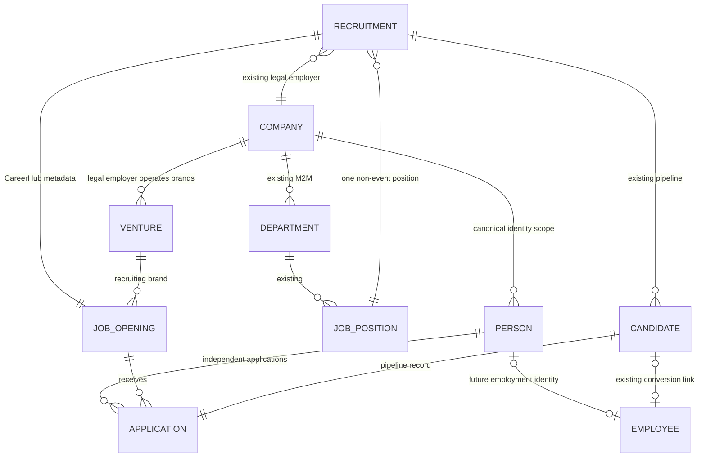

# ADR-001: CareerHub Company and Identity Model

## Status

Accepted for the Phase 2 company-structure and CareerHub-domain increment on 2026-10-25.

## Context

THEVIPGROUP Sp. z o.o. is the sole legal employer. FluxOps, FindMyStay and THEVIPGROUP must be independently visible recruiting brands. Horilla already owns legal companies, departments, job positions, recruitment pipelines, candidate application records and employee records. The extension must allow one human identity to participate in several independent recruitments without rewriting Horilla history or duplicating its HR models.

## Options considered

| Option | Advantages | Costs / risks |
|---|---|---|
| Add venture/person fields directly to Horilla tables | Fewer joins | High upstream merge cost; changes Candidate semantics; cannot cleanly represent multiple Candidates per person |
| Replace Candidate with a new CareerHub application | Full control | Duplicates pipeline/history and creates synchronization failures |
| Add TVG-owned link/extension tables | Preserves Horilla ownership and upgrades; explicit boundaries | Additional joins and validation are required |

## Decision

Use TVG-owned extension/link tables while retaining existing Horilla records as authoritative:

### Legal employer and venture

- `base.Company` remains the legal-employer record. Production configuration must use the single THEVIPGROUP Sp. z o.o. Company for all three ventures.
- `tvg_core.Venture` is presentation/business-area metadata and has a protected foreign key to Company.
- FluxOps, FindMyStay and THEVIPGROUP are separate Venture rows pointing to that same Company. A Venture is not a subsidiary or employer.

### Job opening

- `tvg_careers.JobOpening` is one-to-one with a dedicated, non-event `recruitment.Recruitment`.
- The Horilla Recruitment remains authoritative for title, role description, required skills, vacancies, hiring managers, application opening/closing dates, company, job position, stage pipeline and published/closed flags.
- Existing `JobPosition` remains authoritative for Department.
- JobOpening adds only public slug/id, recruiting Venture, responsibilities, learning outcomes, preferred skills, work location/mode, Erasmus+ applicability, expected start range and duration.
- Draft/published/closed state is derived from Horilla `is_published`, `closed` and `is_active`, preventing a second state machine. State-changing services require explicit publish/close permissions.
- Event-based multi-position recruitments remain valid inside Horilla but cannot back a CareerHub JobOpening. Each independently applicable public role needs its own Recruitment. This also respects Candidate's existing `(email, recruitment)` uniqueness.

### Person and application

- `tvg_core.Person` is a canonical, employer-scoped identity with a random stable UUID. It stores no password and is not candidate signup/authentication.
- Person can link to zero or one existing Employee. Company validation prevents an employee from another legal employer being attached.
- `tvg_careers.Application` is a OneToOne link around an existing Candidate, not a replacement application record. It connects that Candidate to one Person and one JobOpening and supplies an opaque public UUID.
- One Person can therefore link to many Application rows and many independent Candidate rows, while Candidate stages, history, documents, survey answers and employee conversion remain untouched.
- The Phase 4 public CareerHub account refers to the Person UUID through the narrow identity command defined by ADR-003. `Person` remains credential-free, and CareerHub has no direct HR-database access.

## Invariants

1. Venture, Person, Recruitment, JobPosition/Department, managers and Application must resolve to the same legal employer.
2. A JobOpening has one globally unique public slug and one dedicated non-event Recruitment.
3. An Application's Candidate must belong to the JobOpening's Recruitment and JobPosition.
4. One Candidate links to at most one Application; one Person links at most once to a given JobOpening.
5. Core HR foreign keys use `PROTECT` so TVG rows cannot silently destroy Horilla history.
6. Publication and identity/employee linking require dedicated permissions; ordinary model change permission is not treated as publish authority.
7. No automatic email-based merge occurs. Case-insensitive email uniqueness prevents accidental duplicate Person rows within one legal employer, but deliberate identity linking remains a human-authorized action.

## Synthetic demonstration data

`python manage.py seed_tvg_career_demo --company-id <id> --confirm-synthetic` creates or reuses the three Venture rows and creates one draft role per venture. It is idempotent, refuses production mode, uses conspicuous synthetic labels, creates no Candidate/Person/Employee, publishes nothing and sends no mail. It is never run by a migration.

## Consequences and trade-offs

- Upstream Horilla tables and migrations remain unchanged.
- Queries require joins, but relationships and ownership are explicit.
- A public position cannot use Horilla's event-based multi-position Recruitment; separate recruitments are required for independent applications.
- Person email changes and identity reconciliation still need an audited service in a later phase. Authentication/signup and account consent are now implemented by ADR-003; application profile snapshots remain out of scope here.

## Revisit triggers

- Legal employment expands to another company.
- CareerHub is physically separated and needs an external identity mapping rather than same-database foreign keys.
- Horilla changes Candidate uniqueness or introduces a native cross-application person identity.
