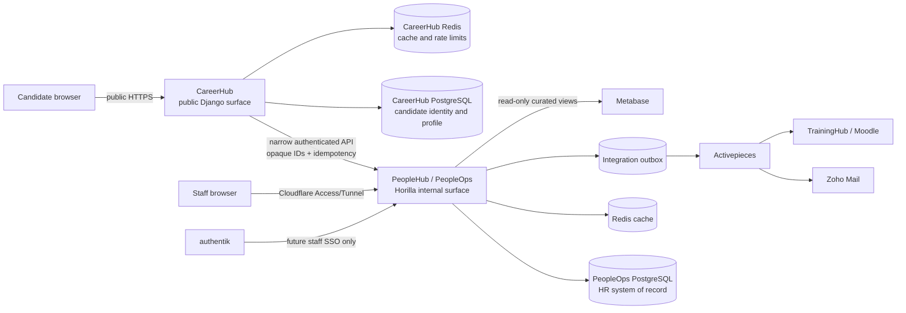

# Target Architecture

## Architectural position

PeopleOps should remain an upgrade-compatible Horilla modular monolith for internal HR. CareerHub should be a separately deployed public surface with its own authentication and least-privilege data store/API access. Both may live in this repository and share build tooling, but they must not share a root URL configuration, session cookie, runtime database role or externally reachable process.

This is a staged architecture: enforce the deployable/security boundary now, retain simple in-repository modules, and split repositories or services only if independent scaling or ownership later justifies it.

Cloudflare controls ingress; it is not the authorization layer. Django permissions, tenant/object checks, private API credentials and separate database roles remain mandatory.

Release configuration is shipped in `horilla/settings/tvg.py`, never dependent
on Docker-excluded local overrides. Production startup does not migrate or clear
static files. The Linux same-host Tunnel topology and strengthened native read/
media boundaries are recorded in
[ADR 017](ADR_017_RELEASE_AUTHORIZATION_AND_CONFIGURATION_BOUNDARIES.md).

## Deployable boundaries

### PeopleHub / PeopleOps

- Host: `people.thevipgroup.eu`.
- Owns Horilla `Recruitment`, `Candidate`, onboarding, `Employee`, leave, attendance, assets, HR documents and approvals.
- Exposes staff UI/API plus a small, explicitly allow-listed CareerHub integration API.
- Never serves public job pages or candidate sessions.
- Uses authentik for staff SSO only after a tested account-linking and break-glass design; Horilla authorization remains authoritative.
- Is reachable through Cloudflare Tunnel/Access or a private network. Gunicorn must not be directly published on a public host port.

### CareerHub

- Host: `career.thevipgroup.eu`.
- Owns candidate authentication, verified email, profile, consent, application drafts and public presentation.
- Uses a dedicated root URLconf containing only health, jobs, candidate account and application routes. No Django admin, Horilla staff routes, `/api/v1/`, media browser or internal documentation is mounted.
- Uses separate cookie names, signing keys, CSRF trusted origins, password-reset URLs, rate limits, storage prefix and runtime database role.
- Submits applications to PeopleOps through a versioned private API. It never uses Horilla's broad Candidate serializers and never connects with a database role that can read HR tables.
- Receives only a minimal status projection: opaque application id, job title, submitted timestamp, candidate-visible state and candidate-visible messages/tasks.

CareerHub's account/profile is not a duplicate Horilla Candidate. It is an authentication principal and reusable pre-application profile. Horilla Candidate remains one submitted application and the recruitment system of record.

### Implemented public catalogue, account and application boundary (Phases 3-5)

CareerHub uses `horilla.settings.careerhub`, `horilla.careerhub_urls` and `horilla.careerhub_wsgi` in a separate Compose service. The runtime has a minimal middleware/template/static configuration, separate key/cookie names, a dedicated PostgreSQL database and dedicated Redis instance, and no HR models or Horilla staff URL tree.

Published roles are read live through `/internal/careerhub/v1/`, mounted only on the PeopleOps root URLconf and denied by the external PeopleOps nginx route. The endpoint requires a dedicated bearer token, fails closed to `TVG_LEGAL_EMPLOYER_ID`, applies an explicit public-field projection and never returns Candidate, Employee, manager, document, note, rating or audit data. Full rationale and residual risks are recorded in `ADR_002_CAREERHUB_PUBLIC_READ_BOUNDARY.md`.

Candidate credentials are owned only by `tvg_careers.accounts` in CareerHub. Signup records a versioned privacy-notice acknowledgement, stores passwords with Django's configured hashers, requires expiring email verification, and uses one-time expiring Django password-reset tokens. Candidate sessions cannot authenticate to PeopleOps or acquire staff permissions. After verification, a separate command credential provisions or confirms the proposed `tvg_core.Person.public_id`; an email collision with a different Person is held for human review rather than auto-merged. PeopleOps masks the legacy email-plus-phone login and candidate self-tracking entry points. Full rationale is recorded in `ADR_003_CAREERHUB_CANDIDATE_AUTHENTICATION.md`.

CareerHub now owns a reusable profile, versioned private CV/cover-letter files,
application drafts and immutable submission-time copies. A third, dedicated
service credential authorizes idempotent submission, candidate-safe status and
owner-requested withdrawal commands. PeopleOps creates one existing Horilla
`Candidate` per opening and links it to the stable Person through the Phase 2
Application model. Details and residual file-scanning risk are recorded in
`ADR_004_CANDIDATE_PROFILE_AND_APPLICATION_SNAPSHOTS.md`.

### Implemented questionnaire boundary

Horilla `SurveyTemplate`, `RecruitmentSurvey` and the Recruitment template
assignment remain authoritative for HR configuration. `tvg_careers` adds only
immutable questionnaire-version and submission-snapshot records. CareerHub
receives opaque public question ids and the safe render schema, freezes the
exact version and complete answers, and submits them through the dedicated
application command. PeopleOps rejects stale, unsupported or cross-employer
configuration before creating the native Horilla answer record.

Initial applications use dedicated PDF/DOCX CV and cover-letter fields;
generic survey-file questions are unavailable so the form cannot be configured
to collect identity documents. A successful transaction creates one
data-minimized `career.application_submitted.v1` outbox event. ADR-005 records
the versioning, attribution and file-safety decision.

### TrainingHub

- Moodle remains its own service and data owner for courses, enrollments, progress and completion evidence.
- PeopleOps owns approved, immutable programme versions, the employment/internship requirement, deadlines and opaque Moodle user/course/enrollment identifiers.
- `tvg_training` supplies a narrow provider contract for account linking, enrollment and bounded progress reconciliation. Its production provider is disabled until an approved Activepieces/Moodle API contract is configured; no Moodle database access is allowed.
- PeopleHub reads only the owning employee's course/status/progress projection. Mandatory overdue items create idempotent, company-scoped supervisor notifications.
- Staff SSO remains a separate future boundary: authentik subjects must be human-linked to active Employees, and external roles are intersected with existing company-scoped Horilla group assignments rather than granting roles during login.

### Automation and analytics

- Activepieces consumes signed, versioned events and calls narrow command endpoints. It must not receive general Horilla JWTs or direct database access.
- Zoho Mail is the production mail transport. Non-production uses a local-memory/file/sink backend and allow-listed recipients.
- Metabase gets a read-only role over curated reporting views, excluding file blobs, authentication data and unnecessary candidate PII.
- The scheduler retains Horilla periodic maintenance. Integration delivery uses a durable outbox/worker with retries and idempotency, not request-process threads.

Phase 15 implements that boundary in `tvg_automation`. Existing CareerHub and
Erasmus domain events are wrapped by a versioned lifecycle record in the same
database transaction. The single scheduler process signs canonical JSON for
Activepieces, retains immutable attempt history, applies bounded retries and
leases, and exposes failures for authorized review. Activepieces callbacks are
HMAC authenticated and may update only workflow-execution history through the
allow-listed endpoint; no generic Horilla model command exists. ADR-014 records
the delivery, replay, template-approval and human-authorization decisions.

## Chosen module boundaries

All proposed names were checked against the repository. None currently exists or conflicts as a Python/Django app label. Use top-level Django apps to match the repository's conventions.

| Module | Owns | Explicitly does not own |
|---|---|---|
| `tvg_core` | venture/business-area taxonomy (`FluxOps`, `FindMyStay`, `THEVIPGROUP`), stable public IDs, shared policy primitives, service-account identity, cross-module event envelope | Candidate, Employee, Recruitment, Leave replacements |
| `tvg_careers` | candidate account/profile/consent/drafts on the public surface; native-survey adapter and immutable questionnaire/application snapshots; application link/status projection; public and integration URLconfs/services | replacement survey/Candidate models, HR stage rules, Employee data, direct broad Horilla API access |
| `tvg_erasmus` | Erasmus case linked to a submitted Candidate, university/program configuration, requirement instances, verification decisions, eligibility checklist and interview-gate policy | generic recruitment pipeline or automatic selection/rejection |
| `tvg_interviews` | verified-candidate invitations, timezone-aware slots/bookings, calendar-provider adapter, reschedule policy, private feedback, human decisions and interview notification outbox | replacement InterviewSchedule/Stage/Candidate records, direct email delivery, automatic decisions |
| `tvg_onboarding` | accepted-intern approval/checklist links, staff-ID sequences, provisioning requests/manual IT fallback, approved access snapshots and asset acknowledgments | replacement Candidate, onboarding, Employee, User, Group or Asset records; invented mailbox APIs or direct email delivery |
| `tvg_peoplehub` | restricted employee dashboard projections, approved request routing, venture links, learning/reporting presentation metadata and portal audit events | replacement Employee, Leave, Attendance, Asset, Project, PMS, Policy, Ticket, User or permission records |
| `tvg_reporting` | internship weekly/monthly submission versions, approved rubric versions, supervisor review history, reminder records and optional advisory AI provenance | replacement Employee, Project, Task, PMS or generic report/export records; automated performance or disciplinary decisions |
| `tvg_offboarding` | Erasmus internship completion gate, approved completion-document versions/signatures, access-revocation proof/exceptions and non-destructive retention review schedules linked to native offboarding | replacement Employee, OffboardingEmployee, AssetAssignment, Erasmus document or reporting records; automatic legal-record deletion or invented provider APIs |
| `tvg_training` | approved reusable programme versions, Moodle account/enrollment mappings, bounded progress/deadline projections, overdue supervisor notifications and staff identity-link/session-revocation controls | Moodle course delivery/content, replacement Employee/User/Group records, automatic role grants or applicant authentication |
| `tvg_analytics` | versioned PeopleOps KPI definitions, aggregate snapshot revisions, reconciliation results, small-cell controls and the curated Metabase reporting-view contract; registrations in Horilla's report catalogue | person-level warehouse data, source-of-record lifecycle state, protected-characteristic analysis, automated employment decisions or broad Metabase database access |
| `tvg_documents` | document type/version metadata, verification records, retention/quarantine/scan state and authorized delivery services linked to existing CandidateDocument/employee Document | duplicate file/document records or generic unscoped attachments |
| `tvg_reports` | weekly/monthly intern report workflow, reviewer decisions and internship-specific metrics; adapters into existing `report` subscriptions | replacement of the existing generic `report` app |
| `tvg_automation` | transactional outbox, delivery attempts, signed event dispatch, idempotency keys, retry/dead-letter state and approval-aware commands | business truth, email passwords or direct hiring decisions |
| `tvg_integrations` | typed adapters and external-id mappings for Moodle, authentik, Zoho, Metabase and Cloudflare-related configuration/health | core workflows, copied external records or plaintext long-lived secrets |

`tvg_documents` coexists deliberately with `horilla_documents`: it adds cross-domain verification/security behavior. `tvg_reports` coexists with `report`: it adds intern-report workflow and delegates generic scheduling/export where possible. ADR-016 supersedes the earlier plan to keep every analytic inside those two boundaries: `tvg_analytics` is now justified by its cross-domain KPI registry, immutable reconciliation snapshots, privacy controls and curated Metabase publication contract, while still registering presentation definitions with Horilla's native `report` app.

## Data ownership and extension rules

| Concept | Authoritative record | Extension approach |
|---|---|---|
| Job/recruitment/stage | Horilla Recruitment/Stage | `tvg_careers.JobOpening` OneToOne metadata for venture/public presentation; one dedicated non-event Recruitment per opening |
| Submitted application | Horilla Candidate | `tvg_careers.Application` OneToOne identity link with opaque UUID; CareerHub retains the immutable submitted profile/document/questionnaire snapshot |
| Stable person identity | `tvg_core.Person` | Employer-scoped UUID identity linked to many Applications and optionally one Employee; no authentication credentials |
| Candidate login/profile | CareerHub account/profile | Separate auth identity; may link to many Horilla Candidate application ids |
| Recruitment questionnaire | Horilla SurveyTemplate/RecruitmentSurvey/Recruitment assignment | Immutable `RecruitmentQuestionnaireVersion`; CareerHub and PeopleOps application snapshots reference the exact version |
| Staff member | Horilla Employee/User/WorkInformation | OneToOne TVG metadata only when Horilla lacks it |
| Employee portal | Native Horilla records through restricted PeopleHub views | Separate hostname/runtime/URLconf; field allowlists and object-level company/team checks |
| Onboarding | Horilla onboarding stages/tasks/portal | Extend workflow; do not reuse the legacy token as candidate auth |
| Erasmus verification | `tvg_erasmus` Screening/Checklist/Case/Requirement/Evidence | OneToOne/foreign-key links through CareerHub Application to native Candidate; the central policy controls interview eligibility |
| Interview scheduling and outcome | `tvg_interviews` invitation/slot/booking/feedback/decision | Each booking links one native `InterviewSchedule`; configured outcomes update the same Candidate through native Stage records |
| Candidate file | Horilla CandidateDocument metadata plus private storage object | Native request/status links remain; identity evidence versions use dedicated `tvg_erasmus` private storage and retention metadata |
| Employee file | `horilla_documents.Document` plus storage object | Same security/retention layer where needed |
| Leave/attendance/assets | Existing Horilla models | Service adapters and TVG-specific acknowledgements only |
| Training content/activity/completion evidence | Moodle | `tvg_training` stores the approved Horilla requirement plus opaque external mappings and bounded status/progress/deadline projection |
| Staff authentication and authorization | authentik / Horilla respectively | `tvg_training.StaffIdentityLink` maps an opaque provider subject after human approval; Horilla company-scoped groups remain authoritative |
| Internship reports | `tvg_reporting` versions linked to native Employee/Project/Task | PeopleHub service layer; human supervisor review and company-scoped status projections |
| Internship completion | Horilla `OffboardingEmployee` and `AssetAssignment` plus `tvg_offboarding.CompletionCase` | Native stages/assets remain authoritative; the TVG gate consumes reporting, university-document, signature and access-revocation evidence before human closure |

Application snapshots capture the profile, independent CV/cover-letter copies,
question/answer labels and submission timestamp used for that application.
Mutable profile changes never rewrite a prior submission. Privacy-notice
acknowledgement remains account-level; if per-application declaration text is
added later, its rendered version must also be copied into the snapshot.

The concrete Phase 2 relationship and trade-off decision is recorded in `ADR_001_CAREERHUB_COMPANY_AND_IDENTITY_MODEL.md`. The public read/deployment decision is recorded in `ADR_002_CAREERHUB_PUBLIC_READ_BOUNDARY.md`. The public credential, session and Person-provisioning boundary is recorded in `ADR_003_CAREERHUB_CANDIDATE_AUTHENTICATION.md`. Profile/application ownership and immutable snapshots are recorded in `ADR_004_CANDIDATE_PROFILE_AND_APPLICATION_SNAPSHOTS.md`. Native survey reuse, immutable form versions, source attribution and the submission event are recorded in `ADR_005_RECRUITMENT_QUESTIONNAIRE_VERSIONING.md`. Human pre-interview screening, private evidence and the interview gate are recorded in `ADR_006_ERASMUS_PRE_INTERVIEW_VERIFICATION.md`. Provider-neutral interview booking and human decisions are recorded in `ADR_007_INTERVIEW_SCHEDULING_AND_HUMAN_DECISIONS.md`.

## Authorization model

Every sensitive operation requires all applicable checks:

1. authenticated principal of the correct class (candidate, staff or service);
2. company/tenant scope;
3. model/action permission or explicit workflow role;
4. object relationship (owner, assigned HR verifier, recruitment manager, reporting manager);
5. workflow precondition (for example verification approval before interview scheduling);
6. field-level response allow-list.

Numeric database ids must not be public identifiers. Use random opaque UUIDs externally. File downloads must resolve an authorized domain object first and then stream the storage object; knowledge of a media path or a valid generic JWT is never sufficient.

The verification gate belongs in a central domain service/policy and database-safe command path used by HTML views, REST endpoints, automation commands and admin actions. UI-only disabling is not enforcement. The current implementation deliberately has no override; any future override requires a dedicated permission, reason, actor, immutable audit event and a new architecture decision.

## Integration contract

Events use a versioned envelope containing event id, type/version, occurred-at
time, environment, company/public object ids, approval evidence and a
data-minimized payload. A separate stable source-derived idempotency key is
retained across retries and replays. Personally identifying fields are excluded
unless the consumer contract explicitly requires them.

Recommended initial event examples:

- `career.application_submitted.v1`
- `erasmus.verification_requested.v1`
- `erasmus.verification_approved.v1`
- `onboarding.employee_created.v1`
- `training.enrollment_requested.v1`
- `intern.report_submitted.v1`

Consumers authenticate independently, verify signatures, enforce replay windows and report success/failure. Side effects that can change candidate status, issue documents or send offers require a staff-approved command in PeopleOps. AI output may be stored as advisory analysis with provenance, but cannot invoke those commands.

## Deployment controls

- Separate CareerHub and PeopleHub services, root URLconfs, settings, secrets, cookies, runtime roles and health checks.
- Bind application ports to the private Docker network or loopback; only the tunnel/reverse proxy is externally reachable.
- Use PostgreSQL least-privilege roles and separate logical databases/schemas for public identity and HR records.
- Use private object storage prefixes/buckets and short-lived authorized downloads. Add malware scanning/quarantine before a file becomes available to reviewers.
- Back up database and media with encrypted, restore-tested procedures. Define retention and erasure rules for unsuccessful applicants and expired identity documents.
- Run exactly one legacy Horilla scheduler until its jobs are made idempotent. Run outbox workers with safe horizontal concurrency/row locking.
- Keep all non-production email and external adapters in fake/sandbox mode by default.

## Architecture decisions to record before implementation

Candidate authentication and CareerHub database separation are now decided in ADR-003; the public job boundary is decided in ADR-002; questionnaire versioning is decided in ADR-005; and the initial verification policy is decided in ADR-006. Decisions still required are:

1. EU/Polish candidate/document retention schedule, lawful basis, final consent text and data-subject request process.
2. File scanning provider and private-object delivery design.
3. authentik account-linking, staff deprovisioning and break-glass access.
4. Whether an exceptional verification override is legally and operationally required; none exists today.
5. Event schema/version policy, Activepieces authentication and operational ownership.
